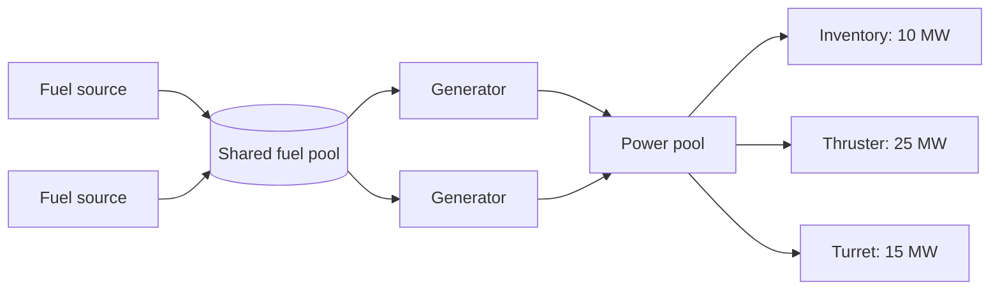
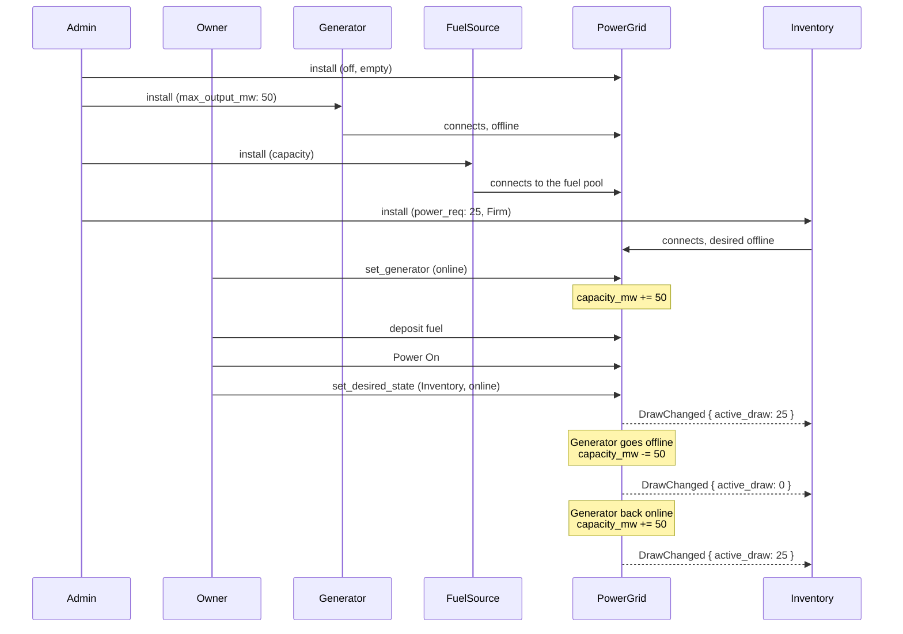

# 5. On-Chain Power Grid

- **Status:** Proposed

## Motivation

A Creation (ship, structure, anything a player builds) has to manage power: fit
generators, burn fuel, and make sure every module that needs power actually
gets it. Today that bookkeeping only happens inside the game client. Moving it
on-chain enables builders to:

- Automate power management across modules through contracts, instead of only
through the game client.
- Make fuel choice a real economic decision: track what is actually spent and
let better fuel last longer.
- Budget fittings arithmetically against a known power ceiling, instead of
guessing.
- Store which modules the owner wants online, and grant power only when the
grid can carry them.
- Let a tribe assign power-management actions to different members through
contract-level permissions.

This ADR covers a deliberately small v1: enough on-chain state and rules to
support power management, not a full port of the game client's power system
(batteries, burst weapon draw, multi-ship power sharing). See [Scope](#scope).

## Summary

A creation has one power grid. The grid is installed first. Installing a
generator, fuel source, or module connects to it.

- **Generators** burn fuel and produce power (MW). More generators raise capacity.
- **Fuel sources** hold the fuel generators burn, pooled together.
- Every other fitting that needs power is a load. Install stores `power_req`,
`draw_kind` (**Firm** or **Elastic**), `power_kind`, `priority`, and `line_loss`.
It starts desired offline.




The owner sets **desired state** (online or offline). It is always stored.
The grant is separate: `active_draw_at_last_settled`.

- **Firm:** every desired-online Firm module draws `power_req`, or none do.
- **Elastic:** leftover watts, in module-id order, up to each `power_req`.

The same rule runs again when capacity changes. Desired state stays. Fuel
hitting zero is not written until the next mutating transaction. Views show
the live fuel and draws. Power Off treats capacity as zero. Generator totals,
fuel, and desired state stay.

**Not covered in v1:** no battery or burst power. Priority is stored and does
not change grants. See [Scope](#scope).

### End-to-end flow




A consuming action checks a grant with `online_requirement`. The grid settles,
then aborts unless the module holds at least `draw` of `draw_kind`:

```move
public fun online_requirement(module_id: u64, draw: u64, draw_kind: DrawKind): Requirement {
    requirement::from_config(
        option::some(component_id()),
        OnlineRequirement { module_id, draw, draw_kind },
    )
}
```


## Scope

**In scope for v1:**

- One `PowerGrid` per Creation, installed before any power component.
- Generators contributing rated output while online.
- Fuel sources pooled into one supply (quantity, impulse, containment burden).
- Modules connected at install, up to `MAX_CONNECTED` (100).
- Firm grants: all desired-online Firm modules draw, or none do.
- Elastic grants: leftover watts, in module-id order.
- Owner-set desired state. Grants recompute from it.
- Priority groups, stored but unused for grants.
- Power On/Off.
- Lazy fuel burn, and owner rules on which fuel may be deposited.

**Out of scope for v1:**

- Batteries, capacitors, and burst draw.
- Cross-Creation power sharing.
- Online or offline by priority group.
- Installing a power component before the grid.


## On-chain design


### Data model


#### `PowerGrid`

```move
public struct PowerGrid has store {
    on: bool,
    fuel_quantity_at_last_settled: u64, // as of last_settled_ms, not live
    fuel_capacity: u64,
    fuel_impulse: u64,
    fuel_containment_burden: u64,
    capacity_mw: u64,                   // sum of online Generators
    last_settled_ms: u64,
    modules: VecMap<u64, ModuleState>,
    generators: VecMap<u64, GeneratorState>,
    fuel_sources: VecMap<u64, u64>,     // id -> capacity
}

public struct ModuleState has copy, drop, store {
    module_spec: ModulePowerSpec,
    desired_online: bool,
    active_draw_at_last_settled: u64,
}

public enum DrawKind has copy, drop, store { Firm, Elastic }
public enum PowerKind has copy, drop, store { Power }
```

Effective capacity is `capacity_mw` while the grid is on and fuel is above zero, else `0`.
`used_mw` is the sum of `active_draw` for modules with a nonzero draw. `line_loss` is stored and ignored by grants and fuel burn in v1.
Values are fixed point at `SCALE = 10_000`. Each mutating call settles fuel burn since
`last_settled_ms`. Views project that burn without writing it.

#### `Generator`

```move
public struct GeneratorState has copy, drop, store {
    max_output_mw: u64,
    containment_reduction: u64,
    base_fuel_rate: u64,
    online: bool,
}
```

Stats live on the grid. Online adds `max_output_mw` to `capacity_mw`.

#### Fuel source

Deposit blends quantity, impulse, and containment burden by weighted average
(`new = (old * old_qty + added * added_qty) / (old_qty + added_qty)`) and aborts
above `fuel_capacity`. Uninstall aborts if settled fuel would exceed the reduced capacity.

#### Consuming modules

Install calls `grid_load::connect` with the module's `Permit<T>` and stores the `ModulePowerSpec`,
desired offline, draw `0`. Uninstall calls `grid_load::disconnect`, which drops the
module and regrants. A module is online when `desired_online` and its draw is nonzero.

### Actions & Requirements

- **Install / uninstall the grid**: admin-gated. Starts off and empty. Uninstall aborts while anything is still connected.
- **Power On / Off**: `set_power_grid`, owner `AccessCap` plus `operate_grid_requirement()`.
- **Desired state**: `set_desired_state`. Always stored. Same transaction regrants.
- **Priority**: `set_priority`. Stored only.
- **Online check**: `online_requirement(module_id, draw, draw_kind)`.
- **Generator**: install connects it with its stats. `set_generator` updates `capacity_mw`.
- **Fuel**: install adds capacity. `deposit_fuel` checks the owner's `FuelRequirement`, then blends.
- **Checks**: `power_grid_requirement(...)` and `generator_requirement(...)`.


### Events

- `PowerGridInstalled`, `PowerGridUninstalled`, `PowerToggled`, `CapacityChanged`
- `GeneratorInstalled`, `GeneratorUninstalled`, `GeneratorConnected`, `GeneratorDisconnected`, `GeneratorToggled`
- `FuelInstalled`, `FuelUninstalled`, `FuelSourceAttached`, `FuelSourceDetached`, `FuelAdded`
- `ModuleConnected`, `ModuleDisconnected`, `PriorityChanged`, `DesiredStateChanged`
- `DrawChanged { module_id, active_draw }`

Depletion shows up in the views.

### Client & PTB discovery

- `projected_fuel`: fuel left now.
- `projected_status`: effective capacity, `used_mw`, online module ids. Fuel at zero reads as capacity `0` and every draw `0`.
- `projected_module_states`: every connected module now. Draw is `0` once fuel has run out. Desired state stays.
- `module_state`: one module as of the last settle.

Stored draws lag until the next mutating action. There is no `settle()` action.

## Consequences

**Easier:** effective capacity, desired state, live draws, and projected fuel are on-chain. 

**Harder / deferred:** no capacitor grace period. One Firm module that does not fit blocks every module. Priority does not change grants yet. A module package must call `grid_load::disconnect` or it leaves a stale row.

## Open questions carried forward

- Whether a module can install when no grid is present.
- Elastic leftover order. Current rule: module-id order.
- How priority groups bring modules online and offline.
- Whether indexers need anything beyond `DrawChanged`.

