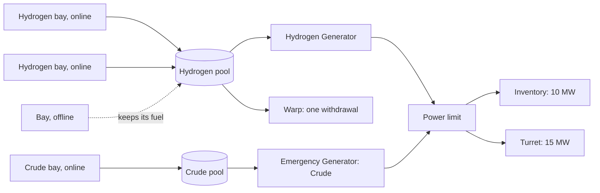
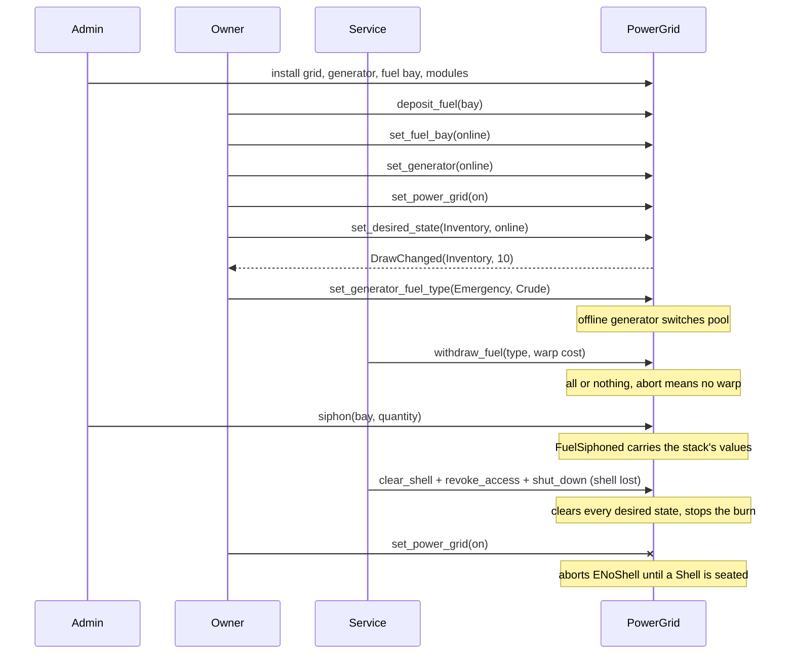

# 5. On-Chain Power Grid

- **Status:** Proposed

## Motivation

A Creation (ship, structure, anything a player builds) has to manage power: fit
generators, burn fuel, and make sure every module that needs power actually
gets it. Today that bookkeeping only happens inside the game client. Moving it
on-chain enables builders to:

- Automate power management across modules through contracts, instead of only
through the game client.
- Make fuel choice a real economic decision: track what is actually spent and
let better fuel last longer.
- Budget fittings arithmetically against a known power ceiling, instead of
guessing.
- Store which modules the owner wants online, and grant power only when the
grid can carry them.
- Write their own shed order, and catch an overload before it happens.

The chain owns module online state and the power rules; the game server follows
the chain. See [Scope](#scope).

## Summary

A Creation has one power grid. The grid is installed first. Installing a
generator, fuel bay, or module connects to it.

- **Fuel bays** each hold one stack of one fuel type: amount, impulse,
containment burden, volatility and thermal inefficiency. A bay locks to the type
of its first deposit until it runs dry. A bay is online or offline; an offline
bay keeps its fuel and feeds nothing.
- **Pools**: the online bays of one fuel type form that type's pool.
- **Generators** each burn one fuel type from its pool and produce power (MW),
scaled by the pool's volatility. A generator never switches type by itself.
- **Modules** draw power from the generators. Each has one online or offline
state. Leap runs on the capacitor; there are no fuel modules.



A pool's bays burn together, each in proportion to what it holds, so they all
run dry at the same moment. A generator's burn uses the amount-weighted average
of its pool's stats. Pools run dry at different moments.

The owner sets each power module's **desired state**. It is always stored and
never refused, even with no fuel. The grant is separate:

- **Firm:** every desired-online Firm module draws `power_req`, or none do.
If they don't fit, the grid **trips**: `on` goes false and nothing draws or
burns. Generator, bay and module switches are unchanged. There is no
built-in shed order.
- **Elastic:** takes what is left after Firm in connect order: the first ask
gets its full `power_req`, the next gets what is left, and so on.

A trip happens on an owner action that no longer fits (`regrant`) or when a
pool runs dry (the run-out step in `project`). It stays until the owner calls
`set_power_grid(true)`; refuelling never resets it.
Desired state survives a trip and Power Off, so Power On brings back every
module set to run.

Nothing is written when fuel runs out. Stored state can be out of date; every
view projects it to the current time, trip included. `settle` stores a trip a
run-out caused before the action changes anything, so fuel added in the same
action can't bring power back.

### End-to-end flow



A consuming action checks a grant with `online_requirement`. The grid settles,
then aborts unless the module holds at least `draw` of `draw_kind`:

```move
public fun online_requirement(module_id: u64, draw: u64, draw_kind: DrawKind): Requirement {
    requirement::from_config(
        option::some(component_id()),
        OnlineRequirement { module_id, draw, draw_kind },
    )
}
```

## Scope

**In scope:**

- One `PowerGrid` per Creation, installed before any power component.
- Fuel bays with one fuel type each, their own fuel and online state; per-type
pools with proportional burn.
- Generators burning one type each, with output scaled by their pool's volatility.
- Power modules (Firm, Elastic).
- Warp (and later jump) fuel as one all-or-nothing withdrawal from one pool.
- Power On/Off, and a service shutdown for a Creation that loses its shell.
- No owner operations without a Shell aboard.
- A removed bay keeps its fuel until it is reinstalled.
- An owner pre-filter requirement that rejects a switch-on that would overload.
- Lazy settlement and projected views.

**Out of scope:**

- Cross-Creation power sharing.

## On-chain design

### Data model

#### `PowerGrid`

```move
public struct PowerGrid has store {
    on: bool,
    last_settled_ms: u64,
    generators: VecMap<u64, GeneratorState>,
    bays: VecMap<u64, FuelBayState>,
    stashed: VecMap<u64, Fuel>,      // fuel of uninstalled bays, by component id
    modules: VecMap<u64, ModuleState>,
}

public struct FuelBayState has copy, drop, store {
    capacity: u64,
    containment_rating: u64,            // set at install; stored only
    online: bool,
    fuel: Fuel,
}

public struct Fuel has copy, drop, store {
    fuel_type: Option<u64>,             // None while empty
    quantity: u64,                      // in stored state: as of last_settled_ms, not live
    impulse: u64,
    containment_burden: u64,            // stored, not used in burn
    volatility: u64,
    thermal_inefficiency: u64,          // stored for siphon and off-chain heat
}

public struct ModuleState has copy, drop, store {
    module_spec: ModulePowerSpec,
    desired_online: bool,
    active_draw_at_last_settled: u64,   // MW granted
}

public enum DrawKind has copy, drop, store { Firm, Elastic }
```

#### `Generator`

```move
public struct GeneratorState has copy, drop, store {
    fuel_type: u64,
    selectable_fuel_types: vector<u64>, // empty for a fixed-type generator
    max_output_mw: u64,
    impulse_limit: u64,
    volatility_limit: u64,
    online: bool,
}
```


### Client & PTB discovery

There is no run-out event on chain; off chain services computes run-out from the views.

- `projected_fuel`, `projected_bays`: fuel now, in total and per bay.
- `projected_pools`: each pool now, by type, with its run-out time if grants hold
  and its burn rate now. Every rate is constant until the earliest run-out or the
  next change to the grid, so a client can drain a gauge between reads without
  reading again. The rate is the one a settle at that moment would use, so it can
  move by a rounding unit between reads; it is rounded up, so the run-out time
  is the real end.
- `projected_module_states`: every module now, draws projected.
- `projected_status`: power limit, `used_mw`, online module ids.
- `module_state`: one module as of the last settle.

Builders run their own shed order by reading these views (`capacity_mw`,
`desired_firm_mw`, each module's `power_req`, `draw_kind` and `priority`) and
switching modules in one owner PTB, for example granting Firm modules in
priority order and skipping any that no longer fit. 

## Consequences

**Harder / deferred:** stored state lags until the next mutating action. One  
Firm module that doesn't fit turns every power module off unless the owner adds  
the pre-filter. A generator never moves to another pool by itself; the owner  
switches it.

