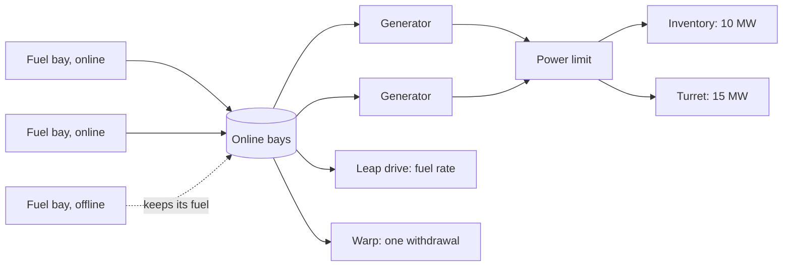
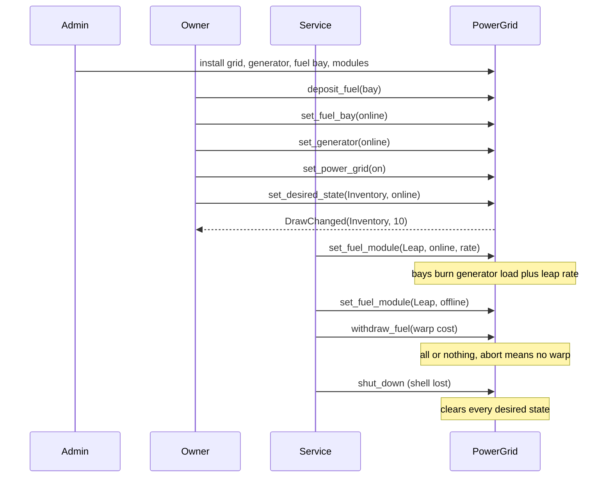

# 5. On-Chain Power Grid

- **Status:** Proposed

## Motivation

A Creation (ship, structure, anything a player builds) has to manage power: fit
generators, burn fuel, and make sure every module that needs power actually
gets it. Today that bookkeeping only happens inside the game client. Moving it
on-chain enables builders to:

- Automate power management across modules through contracts, instead of only
through the game client.
- Make fuel choice a real economic decision: track what is actually spent and
let better fuel last longer.
- Budget fittings arithmetically against a known power ceiling, instead of
guessing.
- Store which modules the owner wants online, and grant power only when the
grid can carry them.
- Write their own shed order, and catch an overload before it happens.

The chain owns module online state and the power rules; the game server follows
the chain. See [Scope](#scope).

## Summary

A Creation has one power grid. The grid is installed first. Installing a
generator, fuel bay, or module connects to it.

- **Fuel bays** each hold their own fuel: amount, impulse, containment burden
and volatility. A bay is online or offline; an offline bay keeps its fuel and
feeds nothing.
- **Generators** burn fuel from the online bays and produce power (MW).
- **Modules** draw either **power** (from the generators) or **fuel** (straight
from the online bays, for leap and overdrive). Each has one online or offline
state.



Online bays burn together, each in proportion to what it holds, so they all
run dry at the same moment. Generator burn uses the amount-weighted average of
the online bays' stats.

The owner sets each power module's **desired state**. It is always stored and
never refused, even with no fuel. The grant is separate:

- **Firm:** every desired-online Firm module draws `power_req`, or none do.
  If they don't fit, every module that needs power goes offline. Generators and
  bays stay online. There is no built-in shed order.
- **Elastic:** shares what is left after Firm, in proportion to each ask, up to
  its `power_req`.

Desired state survives an overload and Power Off, so modules come back by
themselves once everything fits again.

Nothing is written when fuel runs out. Stored state can be out of date; every
view projects it to the current time.

### End-to-end flow



A consuming action checks a grant with `online_requirement`. The grid settles,
then aborts unless the module holds at least `draw` of `draw_kind`:

```move
public fun online_requirement(module_id: u64, draw: u64, draw_kind: DrawKind): Requirement {
    requirement::from_config(
        option::some(component_id()),
        OnlineRequirement { module_id, draw, draw_kind },
    )
}
```

## Scope

**In scope:**

- One `PowerGrid` per Creation, installed before any power component.
- Fuel bays with their own fuel and online state; proportional burn.
- Generators contributing rated output while online and fed.
- Power modules (Firm, Elastic) and fuel modules (leap, overdrive).
- Warp (and later jump) fuel as one all-or-nothing withdrawal.
- Power On/Off, and a service shutdown for a Creation that loses its shell.
- A removed bay keeps its fuel until it is reinstalled.
- An owner pre-filter requirement that rejects a switch-on that would overload.
- Lazy settlement and projected views.

**Out of scope:**

- Docking and heat: game server.
- Run-out time and the fuel-exhausted notification: go-services.
- Batteries, capacitors, and burst draw.
- Cross-Creation power sharing.
- Power control by whoever is in command; power control is owner-only.
- A built-in shed order.

## On-chain design

### Data model

#### `PowerGrid`

```move
public struct PowerGrid has store {
    on: bool,
    last_settled_ms: u64,
    generators: VecMap<u64, GeneratorState>,
    bays: VecMap<u64, FuelBayState>,
    stashed: VecMap<u64, Fuel>,      // fuel of uninstalled bays, by component id
    modules: VecMap<u64, ModuleState>,
}

public struct FuelBayState has copy, drop, store {
    capacity: u64,
    online: bool,
    fuel: Fuel,
}

public struct Fuel has copy, drop, store {
    quantity: u64,                      // in stored state: as of last_settled_ms, not live
    impulse: u64,
    containment_burden: u64,
    volatility: u64,
}

public struct ModuleState has copy, drop, store {
    module_spec: ModulePowerSpec,
    desired_online: bool,
    // Power: MW granted. Fuel: fuel per second while online.
    active_draw_at_last_settled: u64,
}

public enum DrawKind has copy, drop, store { Firm, Elastic }
public enum PowerKind has copy, drop, store { Power, Fuel }
```

- Power values (`power_req`, `max_output_mw`, grants), bay `capacity`,
  deposited fuel amounts, `containment_reduction` and `base_fuel_rate` are
  plain whole numbers. Fuel stats (impulse, containment burden, volatility),
  stored fuel quantity, burn and fuel module rates are fixed point at
  `SCALE = 10_000`, so stats keep fractions (impulse 46.67 is `466_700`) and
  short settles burn fractions. Blends round down at `SCALE`. Capacity checks
  compare `quantity ≤ capacity × SCALE`.
- The power limit is the sum of `max_output_mw` of online generators while the
  grid is on and the online bays hold fuel, else `0`.
- `priority` and `line_loss` are stored on `ModulePowerSpec` and ignored by
  grants. Builders read `priority` for their own shed order.

#### `Generator`

```move
public struct GeneratorState has copy, drop, store {
    max_output_mw: u64,
    containment_reduction: u64,
    base_fuel_rate: u64,
    online: bool,
}
```

Each online generator burns `its share of the load ÷ fuel factor`, where the
fuel factor is `impulse ÷ max(1, burden ÷ containment_reduction)` clamped to
`[1, 100]`, and the share is `load × max_output_mw ÷ power limit`. Fuel with
zero impulse burns `base_fuel_rate`.

#### Fuel bays

- `deposit_fuel` targets one bay and blends its stats by weighted average
  (`new = (old × old_qty + added × added_qty) ÷ (old_qty + added_qty)`).
  It aborts above that bay's capacity.
- Uninstall moves the bay's exact fuel into `stashed`. Reinstalling a bay under
  the same component id takes it back. Stashed fuel can't be burned.
  When the service moves or destroys the bay item, `take_stash` returns the
  fuel as a `FuelLoad` with no abilities, which the same transaction must use:
  `install_with_fuel` refits it on the bay (same id, same tenant),
  `stash_load` stashes it on another Creation, or `destroy_fuel_load` destroys it.
  `take_stash` and `stash_load` are admin actions with
  `manage_stash_requirement()`. `migrate` moves a fitted bay with its fuel in
  one step. The grid can't be uninstalled while it holds a stash.

#### Power modules

Install calls `grid_load::connect` with the module's `Permit<T>` and its
`ModulePowerSpec`, desired offline, draw `0`. Uninstall calls
`grid_load::disconnect`, which drops the module and regrants.

#### Fuel modules (leap, overdrive)

A `PowerKind::Fuel` module has `power_req = 0` (checked at connect) and takes
no part in power grants, `used_mw` or overload. The service switches it with
`set_fuel_module(module_id, online, rate)`, an admin action using
`operate_fuel_module_requirement()`; the owner's `set_desired_state` refuses
it. The rate is fuel per second at `SCALE`. While online and the grid is on,
it burns its rate from the online bays; Power Off pauses it and keeps the rate.
The rate is capped at `max_fuel_rate()` (`u64::MAX ÷ MAX_CONNECTED`), so the
combined rate always fits a u64 and settling can't overflow.
Once the online bays run dry it reads a draw of `0`. `fuel_modules_rate(grid)`
gives the combined rate.

#### Warp

`withdraw_fuel(quantity)` takes `quantity` (at `SCALE`) from the online bays in
proportion to what each holds, all or nothing; shares round down and the
remainder comes off the largest bay. It settles first, so burn counts before
the check, and aborts with `EFuelShort` when the online bays hold less. Offline
bays and stashes don't count. The game server passes the warp's cost minus any
fuel the engine kept from a cut-short warp. If it aborts, there is no warp. It
is an admin action using `withdraw_fuel_requirement()` and emits
`FuelWithdrawn { quantity, remaining }`.

### Settlement and projection

Between transactions the total burn is constant:

```
rate = Σ generator burn + Σ online fuel module rates
burn = min(Q, rate × elapsed)        // Q = fuel in online bays
bay_i = qty_i × (Q − burn) ÷ Q       // qty_i = stored quantity, online bays only
```

Generator burn uses the amount-weighted stats of the online bays, which stay
constant between settles because every bay burns the same fraction. Each bay's
share rounds down; the remainder comes off the largest online bay.

Every mutating call settles this into stored state first. Nothing settles at
run-out. Past run-out (`Q ÷ rate` after the last settle), the online bays read
empty, generators give `0`, and fuel modules get no fuel.

### Actions & Requirements

| Action | Who | Notes |
|---|---|---|
| Install / uninstall grid, generator, bay, module | admin | grid uninstall aborts while anything is connected |
| `set_power_grid` (Power On / Off) | owner | keeps every desired state |
| `set_generator` | owner | |
| `set_fuel_bay` | owner | offline bays keep their fuel |
| `take_stash` | admin | returns an uninstalled bay's stash as a `FuelLoad` |
| `stash_load` | admin | stashes a `FuelLoad` on another Creation |
| `install_with_fuel` | admin | installs a bay holding its `FuelLoad` |
| `destroy_fuel_load` | holder of the load | destroys fuel whose bay item is gone |
| `deposit_fuel` | owner + sponsor | checks the owner's `FuelRequirement` |
| `set_desired_state` | owner | power modules; never refused |
| `set_priority` | owner | stored only |
| `set_fuel_module` | admin | fuel modules; online with a rate (at `SCALE`), offline with none |
| `withdraw_fuel` | admin | all or nothing, at `SCALE` |
| `shut_down` | admin | shell lost: clears every desired state and takes generators and bays offline |

Requirements:

- `online_requirement(module_id, draw, draw_kind)`: the module holds a grant.
- `power_grid_requirement(...)` and `generator_requirement(...)`: grid and
  generator checks.
- `deposit_fuel_requirement(...)`: which fuel a deposit accepts.
- `fits_requirement()`: the pre-filter, resolved by `assert_fits`. The owner
  puts it after the grid operation in their power actions (for example
  `[operate_grid_requirement(), fits_requirement()]`); it aborts with
  `EWouldOverload` if `desired_firm_mw` exceeds `capacity_mw`, the online
  generators' output. That covers switch-ons and generators going offline.
  Elastic asks never overload. It can't catch fuel running out.

Power Off (player-signed) keeps intent. `shut_down` clears it, so everything stays off until the owner switches it on.
`shut_down` is an admin action using `shut_down_requirement()`: it settles,
clears every module's desired state (fuel modules lose their rate), takes every
generator and bay offline, leaves `on` unchanged, and emits `GridShutDown`. The
service calls it in the same PTB as the Layout edit that removes the Shell, so
`power` keeps no dependency on `creation`.

### Events

- `PowerGridInstalled`, `PowerGridUninstalled`, `PowerToggled`, `GridShutDown`
- `GeneratorInstalled`, `GeneratorUninstalled`, `GeneratorConnected`, `GeneratorDisconnected`, `GeneratorToggled`, `CapacityChanged`
- `FuelBayInstalled`, `FuelBayUninstalled`, `FuelBayAttached`, `FuelBayDetached`, `FuelBayToggled`, `FuelAdded`, `FuelWithdrawn`, `FuelStashed`, `FuelRestored`, `FuelUnstashed`, `FuelLoadDestroyed`
- `ModuleConnected`, `ModuleDisconnected`, `PriorityChanged`, `DesiredStateChanged`, `FuelModuleToggled`
- `DrawChanged { module_id, active_draw }`

There is no run-out event on chain; off chain services computes run-out from the views.

### Client & PTB discovery

- `projected_fuel`, `projected_bays`: fuel now, in total and per bay.
- `stashed_fuel`: an uninstalled bay's stash, which never burns.
- `projected_module_states`: every module now, draws projected.
- `module_status`, `module_statuses`, `generator_status`: why each is or isn't
  running now, as a `PowerStatus`, checked in this order: `Off` (switched off),
  `GridOff` (Power Off), `NoFuel` (no bay holds fuel), `BaysOffline` (online
  bays empty, an offline bay holds fuel), `NoPower` (a power module the grid
  can't carry), else `Online`. A generator refused fuel stays online and reads
  `NoFuel` or `BaysOffline`; it supplies again once fuel reaches an online bay.
- `projected_status`: power limit, `used_mw`, online module ids.
- `module_state`: one module as of the last settle.

Builders run their own shed order by reading these views (`capacity_mw`,
`desired_firm_mw`, each module's `power_req`, `draw_kind` and `priority`) and
switching modules in one owner PTB, for example granting Firm modules in
priority order and skipping any that no longer fit. Choosing a bay to fill ("most room", "fill all") is a PTB
helper over `deposit_fuel`.

## Consequences

**Easier:** per-bay fuel, the power limit, desired state, live draws and
projected fuel are on-chain. Fuel use for leap, overdrive and warp is accounted
on-chain. Projections are closed-form, so off-chain services can simulate them.

**Harder / deferred:** stored state lags until the next mutating action. One
Firm module that doesn't fit turns every power module off unless the owner adds
the pre-filter. The service must switch fuel modules, call `shut_down`, and
take each stash when its bay item moves or is destroyed. A module package must call `grid_load::disconnect` or it leaves a
stale row.

