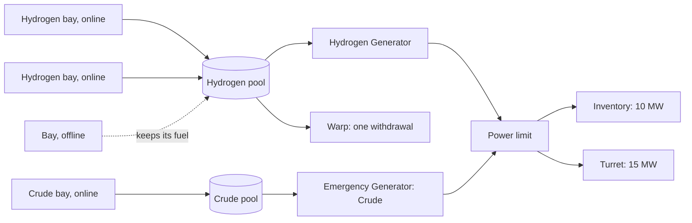
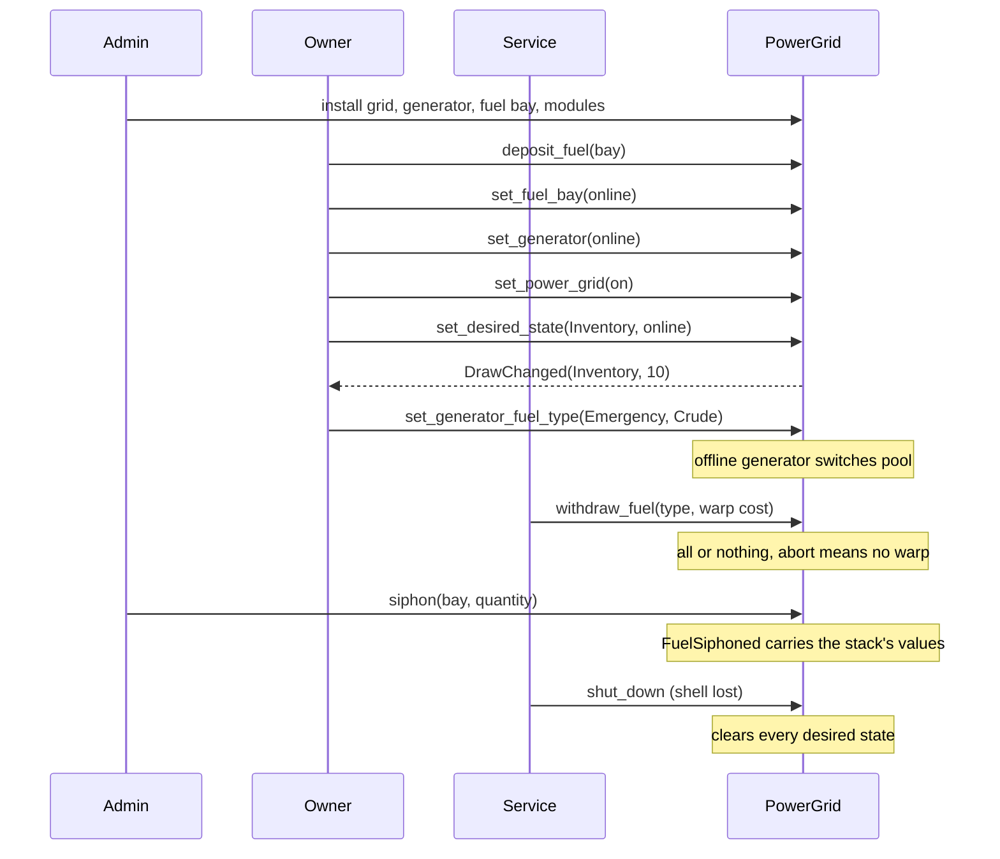

# 5. On-Chain Power Grid

- **Status:** Proposed

## Motivation

A Creation (ship, structure, anything a player builds) has to manage power: fit
generators, burn fuel, and make sure every module that needs power actually
gets it. Today that bookkeeping only happens inside the game client. Moving it
on-chain enables builders to:

- Automate power management across modules through contracts, instead of only
through the game client.
- Make fuel choice a real economic decision: track what is actually spent and
let better fuel last longer.
- Budget fittings arithmetically against a known power ceiling, instead of
guessing.
- Store which modules the owner wants online, and grant power only when the
grid can carry them.
- Write their own shed order, and catch an overload before it happens.

The chain owns module online state and the power rules; the game server follows
the chain. See [Scope](#scope).

## Summary

A Creation has one power grid. The grid is installed first. Installing a
generator, fuel bay, or module connects to it.

- **Fuel bays** each hold one stack of one fuel type: amount, impulse,
containment burden, volatility and thermal inefficiency. A bay locks to the type
of its first deposit until it runs dry. A bay is online or offline; an offline
bay keeps its fuel and feeds nothing.
- **Pools**: the online bays of one fuel type form that type's pool.
- **Generators** each burn one fuel type from its pool and produce power (MW),
scaled by the pool's volatility. A generator never switches type by itself.
- **Modules** draw power from the generators. Each has one online or offline
state. Leap runs on the capacitor; there are no fuel modules.



A pool's bays burn together, each in proportion to what it holds, so they all
run dry at the same moment. A generator's burn uses the amount-weighted average
of its pool's stats. Pools run dry at different moments.

The owner sets each power module's **desired state**. It is always stored and
never refused, even with no fuel. The grant is separate:

- **Firm:** every desired-online Firm module draws `power_req`, or none do.
  If they don't fit, every module that needs power goes offline. Generators and
  bays stay online. There is no built-in shed order.
- **Elastic:** takes what is left after Firm in connect order: the first ask
  gets its full `power_req`, the next gets what is left, and so on.

Desired state survives an overload and Power Off, so modules come back by
themselves once everything fits again.

Nothing is written when fuel runs out. Stored state can be out of date; every
view projects it to the current time.

### End-to-end flow



A consuming action checks a grant with `online_requirement`. The grid settles,
then aborts unless the module holds at least `draw` of `draw_kind`:

```move
public fun online_requirement(module_id: u64, draw: u64, draw_kind: DrawKind): Requirement {
    requirement::from_config(
        option::some(component_id()),
        OnlineRequirement { module_id, draw, draw_kind },
    )
}
```

## Scope

**In scope:**

- One `PowerGrid` per Creation, installed before any power component.
- Fuel bays with one fuel type each, their own fuel and online state; per-type
  pools with proportional burn.
- Generators burning one type each, with output scaled by their pool's volatility.
- Power modules (Firm, Elastic).
- Warp (and later jump) fuel as one all-or-nothing withdrawal from one pool.
- Admin siphon out of a named bay.
- Power On/Off, and a service shutdown for a Creation that loses its shell.
- A removed bay keeps its fuel until it is reinstalled.
- An owner pre-filter requirement that rejects a switch-on that would overload.
- Lazy settlement and projected views.

**Out of scope:**

- Docking and heat (from burn and the pool's thermal inefficiency): game server.
- The fuel-exhausted notification: go-services.
- Checking deposits against a bay's containment rating (stored only for now).
- Batteries, capacitors, and burst draw.
- Cross-Creation power sharing.
- Power control by whoever is in command; power control is owner-only.
- A built-in shed order.

## On-chain design

### Data model

#### `PowerGrid`

```move
public struct PowerGrid has store {
    on: bool,
    last_settled_ms: u64,
    generators: VecMap<u64, GeneratorState>,
    bays: VecMap<u64, FuelBayState>,
    stashed: VecMap<u64, Fuel>,      // fuel of uninstalled bays, by component id
    modules: VecMap<u64, ModuleState>,
}

public struct FuelBayState has copy, drop, store {
    capacity: u64,
    containment_rating: u64,            // set at install; stored only
    online: bool,
    fuel: Fuel,
}

public struct Fuel has copy, drop, store {
    fuel_type: Option<u64>,             // None while empty
    quantity: u64,                      // in stored state: as of last_settled_ms, not live
    impulse: u64,
    containment_burden: u64,            // stored, not used in burn
    volatility: u64,
    thermal_inefficiency: u64,          // stored for siphon and off-chain heat
}

public struct ModuleState has copy, drop, store {
    module_spec: ModulePowerSpec,
    desired_online: bool,
    active_draw_at_last_settled: u64,   // MW granted
}

public enum DrawKind has copy, drop, store { Firm, Elastic }
```

- Power values (`power_req`, `max_output_mw`, grants), bay `capacity` and
  deposited fuel amounts are plain whole numbers. Fuel stats, generator limits,
  the containment rating, stored fuel quantity and burn are fixed point at
  `SCALE = 10_000`, so stats keep fractions (impulse 46.67 is `466_700`) and
  short settles burn fractions. Blends round down at `SCALE`. Capacity checks
  compare `quantity ≤ capacity × SCALE`.
- A pool is not stored: `pool_fuel(grid, fuel_type)` blends the online bays of
  that type.
- The power limit is the sum of generator outputs while the grid is on, else `0`.
- `priority` and `line_loss` are stored on `ModulePowerSpec` and ignored by
  grants. Builders read `priority` for their own shed order.

#### `Generator`

```move
public struct GeneratorState has copy, drop, store {
    fuel_type: u64,
    selectable_fuel_types: vector<u64>, // empty for a fixed-type generator
    max_output_mw: u64,
    impulse_limit: u64,
    volatility_limit: u64,
    online: bool,
}
```

| What | Formula |
|---|---|
| Usable impulse | `min(pool impulse, impulse_limit)` |
| Volatility share | `min(pool volatility × SCALE ÷ volatility_limit, SCALE)`, at least 1 while volatility > 0 |
| Output | `max_output_mw × share ÷ SCALE` (floor, at least 1 MW while share > 0) while online and its pool holds fuel, else `0` |
| Load share | `load × output ÷ power limit`, `load = min(used MW, power limit)` |
| Burn | `ceil(load share × SCALE² × elapsed_ms ÷ (usable impulse × 1000))` |

Burden plays no part in burn. The `min` stand-ins will become a smooth curve;
only `fuel_math` changes. A generator with an empty pool stays online and
supplies nothing; it supplies again once fuel of its type reaches an online
bay. The owner switches an offline Emergency Generator to another selectable
type with `set_generator_fuel_type`.

#### Fuel bays

- `deposit_fuel` targets one bay and blends its stats by weighted average
  (`new = (old × old_qty + added × added_qty) ÷ (old_qty + added_qty)`).
  It aborts above that bay's capacity, on zero impulse, and on a type other
  than the one a non-empty bay holds. A bay that runs dry clears its type.
- Uninstall moves the bay's exact fuel into `stashed`. Reinstalling a bay under
  the same component id takes it back. Stashed fuel can't be burned.
  When the service moves or destroys the bay item, `take_stash` returns the
  fuel as a `FuelLoad` with no abilities, which the same transaction must use:
  `install_with_fuel` refits it on the bay (same id, same tenant),
  `stash_load` stashes it on another Creation, or `destroy_fuel_load` destroys it.
  `take_stash` and `stash_load` are admin actions with
  `manage_stash_requirement()`. `migrate` moves a fitted bay with its fuel in
  one step. The grid can't be uninstalled while it holds a stash.
- A grid holds at most `MAX_FUEL_BAYS` (32) bays, fitted plus stashed. A new
  bay or an arriving stash aborts past it; uninstalling or refitting keeps the
  total. Each bay's `capacity` is at most `u64::MAX ÷ (SCALE × MAX_FUEL_BAYS)`,
  so the fuel of every bay at `SCALE` fits a u64.

#### Power modules

Install calls `grid_load::connect` with the module's `Permit<T>` and its
`ModulePowerSpec`, desired offline, draw `0`. Uninstall calls
`grid_load::disconnect`, which drops the module and regrants.

#### Warp

`withdraw_fuel(fuel_type, quantity)` takes `quantity` (at `SCALE`) from that
type's pool, each online bay giving in proportion to what it holds, all or
nothing; shares round down and the remainder comes off the largest bay. It
settles first, so burn counts before the check, and aborts with `EFuelShort`
when the pool holds less. Offline bays, other types and stashes don't count.
The game server passes the warp's cost minus any fuel the engine kept from a
cut-short warp. If it aborts, there is no warp. It is an admin action using
`withdraw_fuel_requirement()` and emits `FuelWithdrawn { fuel_type, quantity,
remaining }`. Warp itself is on hold; the call stays.

#### Siphon

`siphon(fuel_bay_id, quantity)` takes `quantity` (at `SCALE`) out of one bay,
online or offline. It settles first, aborts with `EBayShort` when the bay holds
less, clears the type if the bay is left empty, and regrants. It is an admin
action using `siphon_requirement()` and emits `FuelSiphoned` with the bay's
type and stats, from which the service mints the stack.

### Settlement and projection

Between run-outs each pool's burn rate is constant: its generators' burns at
the grants stored at the last settle. A pool's stats stay constant too, because
its bays burn the same fraction. Each bay's share rounds down; the remainder
comes off the largest online bay of that pool.

Pools run dry at different moments, so settle and every view step through them:

1. With current grants, find each pool's run-out (binary search, since burn rounds up).
2. Burn every pool up to the earliest run-out before now; that pool is empty.
3. Recompute capacity and grants with the same function `regrant` uses, without
   events. If Firm needs no longer fit, every module draws `0`.
4. Repeat until now. At most one step per pool.

Settle writes only the bays; grants between steps are never stored. The
caller's `regrant` then emits `DrawChanged` for the net move, so a lazy read
matches a settle at any time. Nothing settles at run-out on its own.

### Actions & Requirements

| Action | Who | Notes |
|---|---|---|
| Install / uninstall grid, generator, bay, module | admin | grid uninstall aborts while anything is connected |
| `set_power_grid` (Power On / Off) | owner | keeps every desired state |
| `set_generator` | owner | |
| `set_fuel_bay` | owner | offline bays keep their fuel |
| `take_stash` | admin | returns an uninstalled bay's stash as a `FuelLoad` |
| `stash_load` | admin | stashes a `FuelLoad` on another Creation |
| `install_with_fuel` | admin | installs a bay holding its `FuelLoad` |
| `destroy_fuel_load` | holder of the load | destroys fuel whose bay item is gone |
| `deposit_fuel` | owner + sponsor | type lock, impulse > 0, the owner's `FuelRequirement` |
| `set_generator_fuel_type` | owner | offline generator, a selectable type |
| `set_desired_state` | owner | never refused |
| `set_priority` | owner | stored only |
| `withdraw_fuel` | admin | one type's pool, all or nothing, at `SCALE` |
| `siphon` | admin | one bay, online or not, at `SCALE` |
| `shut_down` | admin | shell lost: clears every desired state and takes generators and bays offline |

Requirements:

- `online_requirement(module_id, draw, draw_kind)`: the module holds a grant.
- `power_grid_requirement(...)` and `generator_requirement(...)`: grid and
  generator checks.
- `deposit_fuel_requirement(...)`: which fuel a deposit accepts.
- `fits_requirement()`: the pre-filter, resolved by `assert_fits`. The owner
  puts it after the grid operation in their power actions (for example
  `[operate_grid_requirement(), fits_requirement()]`); it aborts with
  `EWouldOverload` if `desired_firm_mw` exceeds `capacity_mw`, the online
  generators' output. That covers switch-ons and generators going offline.
  Elastic asks never overload. It can't catch fuel running out.

Power Off (player-signed) keeps intent. `shut_down` clears it, so everything stays off until the owner switches it on.
`shut_down` is an admin action using `shut_down_requirement()`: it settles,
clears every module's desired state, takes every
generator and bay offline, leaves `on` unchanged, and emits `GridShutDown`, which
stands for every toggle and the drop to 0 capacity (no per-item events). The
service calls it in the same PTB as the Layout edit that removes the Shell, so
`power` keeps no dependency on `creation`.

### Events

- `PowerGridInstalled`, `PowerGridUninstalled`, `PowerToggled`, `GridShutDown`
- `GeneratorInstalled`, `GeneratorUninstalled`, `GeneratorConnected`, `GeneratorDisconnected`, `GeneratorToggled`, `CapacityChanged`
- `GeneratorFuelTypeChanged`
- `FuelBayInstalled`, `FuelBayUninstalled`, `FuelBayAttached`, `FuelBayDetached`, `FuelBayToggled`, `FuelAdded`, `FuelWithdrawn`, `FuelSiphoned`, `FuelStashed`, `FuelRestored`, `FuelUnstashed`, `FuelLoadDestroyed`
- `ModuleConnected`, `ModuleDisconnected`, `PriorityChanged`, `DesiredStateChanged`
- `DrawChanged { module_id, active_draw }`

There is no run-out event on chain; off chain services computes run-out from the views.

### Client & PTB discovery

- `projected_fuel`, `projected_bays`: fuel now, in total and per bay.
- `projected_pools`: each pool now, by type, with its run-out time if grants hold.
- `stashed_fuel`: an uninstalled bay's stash, which never burns.
- `projected_module_states`: every module now, draws projected.
- `module_status`, `module_statuses`, `generator_status`: why each is or isn't
  running now, as a `PowerStatus`, checked in this order: `Off` (switched off),
  `GridOff` (Power Off), `NoFuel` (a generator's pool is empty; for a module,
  every online generator's pool), `BaysOffline` (empty only because the bays
  holding that type are offline), `NoPower` (a module the grid can't carry),
  else `Online`.
- `projected_status`: power limit, `used_mw`, online module ids.
- `module_state`: one module as of the last settle.

Builders run their own shed order by reading these views (`capacity_mw`,
`desired_firm_mw`, each module's `power_req`, `draw_kind` and `priority`) and
switching modules in one owner PTB, for example granting Firm modules in
priority order and skipping any that no longer fit. Choosing a bay to fill ("most room", "fill all") is a PTB
helper over `deposit_fuel`.

## Consequences

**Easier:** per-bay fuel, per-type pools, the power limit, desired state, live
draws and projected fuel are on-chain. Fuel use for warp and siphon is
accounted on-chain. Projections step through each pool's run-out with the same
function settle uses, so off-chain services can simulate them.

**Harder / deferred:** stored state lags until the next mutating action. One
Firm module that doesn't fit turns every power module off unless the owner adds
the pre-filter. A generator never moves to another pool by itself; the owner
switches it. The service must call `shut_down`, mint siphoned stacks, and
take each stash when its bay item moves or is destroyed. A module package must call `grid_load::disconnect` or it leaves a
stale row.

