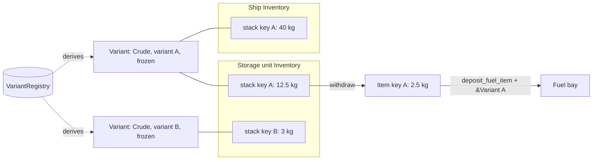
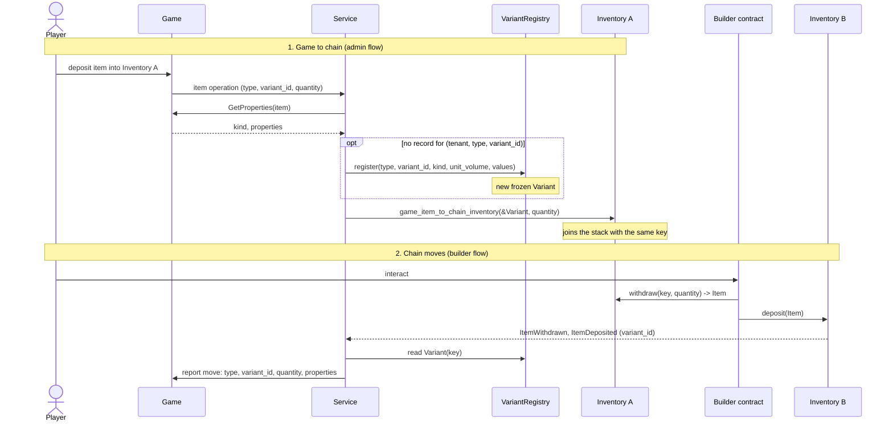

# 6. Neo Types On-Chain

- **Status:** Proposed
- **Relates to:** [0002-modular-architecture](0002-modular-architecture.md),
[0003-onchain-inventory-design](0003-onchain-inventory-design.md),
[0005-onchain-power-network](0005-onchain-power-network.md)

## Motivation

In the game, an item's qualities come from what it was made of. Each stack of a
NeoType carries its own property values (density, hardness, fuel impulse, ...),
so two stacks of the same type can differ. One exact set of values is a
**variant**. Stacks of the same variant join; stacks of different variants never
do. Materials are measured in kg to 4 decimals; countable items in whole units.

Today the chain knows only `type_id` and a whole-unit quantity. Stacks merge by
type, volume is per type, and fuel values reach the power grid as free arguments
from the service. Putting variants on chain enables builders to:

- Read an item's properties in their own contracts: sort, filter or price storage
by quality.
- Move fuel between an inventory and a fuel bay on chain, with the grid reading
the fuel's values from the item itself.
- Rely on the game's stacking rule on chain: different variants stay apart.

The game sets every variant's values (crafting, loot, default variant); the chain
stores and checks them, never invents one.

## Summary

Each variant gets one **frozen** `Variant` **record** holding all its property
values, at an address derived from `(tenant, type_id, variant_id)`. `variant_id` is
the game's variant ID, and it names one fixed set of values for good: the game
resolves `(type_id, sha256(properties))` to one ID and never rewrites a variant's
values.

- **Stacks and items** store only the `VariantKey` and a quantity. An inventory has
one stack per key, so identical variants join and different ones don't.
- **Quantity** is a plain `u64` in base units: a count of items, or a stack's total
mass at 1e9, the proto's nanos (12.5 kg is 12,500,000,000). The game keeps 4
decimals; 1e9 matches the proto with no conversion and leaves room. The record's
`QuantityKind` says which; arithmetic never branches on it.
- **Volume** comes from the variant: the record holds m³ per kg (1/density) or
per item, and a stack's volume is that times its kg or item count.
- **A value change** moves stock to a new variant ID in the game, so a new frozen
record. Old stacks keep their key and values.
- **Any contract** reads properties by passing `&Variant`. Fuel deposits read the
four fuel properties from it.



### End-to-end flow

1. **Game to chain (admin flow).** A player deposits an item into an on-chain

   Inventory. The service pulls the item's properties from the game, registers a
     `Variant` record if the chain doesn't have one yet, then mints the stack.
2. **Chain moves (builder flow).** A builder contract moves items between

   Inventories (or into a fuel bay). The service listens to the item events and
     reports each move to the game with the variant's properties.



Registration is its own admin transaction: `register` creates the record and
freezes it at once. The bridge-in that follows passes the frozen record; a variant
already on chain skips registration. The game learns of chain moves only from
events, which carry the variant key; the service reads the record and reports
the properties with the move. Bridge-out (`chain_item_to_game_inventory`) is
reported the same way. The game resolves an item coming back by its `variant_id`,
never by re-hashing the reported values: values rounded to 1e9 would hash to a
different variant than the original floats.

## Scope

**In scope:**

- One frozen `Variant` record per variant that crosses to the chain, with all its
properties.
- Inventory stacks and `Item`s keyed by variant; quantity in base units; volume
from the record.
- Value changes: a new variant ID is a new frozen record; old stacks keep theirs.
- Items with no properties (plain types) as a record with `variant_id = 0` and no
values.
- Fuel deposits (service and on-chain `Item`) reading fuel values from a record.

**Out of scope:**

- Property names, images: off chain (static data, API).
- Recipes, material processing, blending outside a fuel bay.
- Singletons (assembled, unstacked items): not bridged; repackage first.

## On-chain design

### Data model

#### `Variant`

```move
public struct VariantKey has copy, drop, store {
    tenant: String,
    type_id: u64,
    variant_id: u64,            // game variantID; 0 = no variant
}

public enum QuantityKind has copy, drop, store {
    Units,                      // base unit = 1 item
    Mass,                       // base unit = 1e-9 kg
}

public struct Value has copy, drop, store {
    magnitude: u128,            // at 1e9: |units| × 1e9 + |nanos|
    negative: bool,             // a few physical properties go below zero
}

public struct Variant has key {
    id: UID,                    // derived from VariantRegistry + key
    key: VariantKey,
    kind: QuantityKind,
    unit_volume: u64,           // m³ per kg (Mass) or per item (Units), at 1e9
    values: VecMap<u32, Value>, // property_id, value, ascending by id
}

public struct VariantRegistry has key { id: UID }
```

`register` takes the property IDs strictly ascending and aborts otherwise, so
every reader sees one order. It is admin-gated (`AdminACL` admins): only the game
service registers variants, and the chain trusts it to pair a `variant_id` with
its real values. A second `register` for the same key aborts, so the first
registration stands.

Admins are global: any admin can register under any tenant, and the service is
trusted to pick the right one. Tenant-scoped admins are not planned.

A rebalance or migration that conforms stock to new ranges moves the game's items
to a new `variant_id`; new stacks bridge in under that ID. Variants already on
chain are pinned in the game and marked **deprecated**: the game mints no new
stock of them, and chain stock bridged back is taken as it is. The chain needs no
change; the old record stays frozen and its stacks keep working.

#### `Item` and `ItemBag`

```move
public struct Item has key {
    id: UID,
    key: VariantKey,
    quantity: u64,              // base units
    unit_volume: u64,
    source: ID,
}

public struct Balance has drop, store { quantity: u64, unit_volume: u64 }

public struct ItemBag has store { balances: LinkedTable<VariantKey, Balance> }
```

#### Packages

`Variant` and `VariantRegistry` live in a new `variant` package that depends only
on `core`. `power` and `inventory` both depend on `variant`; `power` never depends
on `inventory`, which already depends on `power`.

#### Fuel

`deposit_fuel` (service path, in `power`) takes `&Variant` and an amount instead
of the four fuel values.

`deposit_fuel_item` lives in `inventory`. It takes an `Item` and its `&Variant`,
burns the item, and loads the fuel through `deposit_fuel`.

Both paths read the fuel properties by fixed ID and convert to the grid's `SCALE` (1e4):

```move
const IMPULSE: u32 = 208;
const THERMAL_INEFFICIENCY: u32 = 209;
const CONTAINMENT_BURDEN: u32 = 210;
const VOLATILITY: u32 = 211;
```

The fuel type is `key.type_id`. Amounts go from 1e9 to the grid's `SCALE` by
dividing by 10^5, which drops anything below 0.0001 kg; how the chain keeps `Mass`
amounts on that step is decided in the inventory PR. Zero impulse, a missing fuel
property or `Units` kind aborts.

A bay keeps only the fuel type and four blended stats at `SCALE`, not a variant.
A siphon emits those values (as `FuelSiphoned` does today); the service asks the
game which variant that fuel is, registers it if new, and mints the stack. The
chain never rebuilds the original variant: blending and the drop from 1e9 to 1e4
precision make that the game's call.

### Client & PTB discovery

- `variant::derive_id(registry, key)`: the record's object ID, so clients and the
service find a record without an index.
- `variant::value(v, property_id)`, `value_u64`, `property_ids`, `kind`,
`decimals`, `unit_volume`.
- `inventory::balance_of(entity, component_id, key)`; `item::key`, `quantity`.
- `VariantRegistered { key, id, kind }` for indexers; item movement events carry
`variant_id`; `FuelItemDeposited` for items burned into a bay.

Builders gate on properties in their own requirement handler, declared just
before the deposit in the action. The handler takes the `Item` and its
`&Variant`, checks `item.key == variant.key` and any property, then passes that
same `Item` to `inventory::deposit` in the same call. A check on one item can't
let a different item through. Core `ItemRequirement` stays type and quantity only.

## Alternatives Considered

1. **One object per stack, ID derived from** `(type_id, variant_id)`**.** A global ID

   allows only one stack of a variant on the whole chain, and a derived address
     can't be reclaimed after the stack empties.
2. **Typed fields for on-chain properties, the rest as JSON bytes.** Move can't

   parse JSON, so contracts can't read it; it costs storage on every stack. Typed
     fields differ per item kind and need many `Option`s or a type parameter.
3. **All values copied onto every stack and item.** No extra argument to read,

   but the same values are stored many times.
4. **Key by a hash of the values, computed on chain.** The chain could check that

   a key matches its values, but keys grow to 32 bytes and the game would need a
     hash-to-variant map for items coming back. The game already guarantees one ID
     per set of values, and the bridge already trusts the game service.
5. **A quantity enum (**`Units(u64) | Mass(u64)`**) on each stack.** Mirrors the API

   but makes every add, split and merge match on the kind. Base units with the
     kind on the record keep one arithmetic path.
6. **Fuel property mapping in an admin config object.** Changeable without an

   upgrade, but every deposit reads one more shared object for IDs that are fixed
     in static data.

## Consequences

- New shared object: `VariantRegistry`. One frozen `Variant` per variant that ever
crosses; never deleted.
- Bridge-in, `deposit_fuel` and property reads take a `&Variant` argument. 
- Stack keys grow from a `u64` to a `VariantKey` (tenant, type, variant).
- Requirements on the game:
  - The API carries `variant_id`.
  - Every variant registered on chain is kept from the orphan sweep for good
  (as `Variant_PinForChain` does for the interim bridge); otherwise a bridge-out
  would name a variant the game no longer has.
  - A migrated variant that is pinned for the chain is marked deprecated, not
  rewritten.
- Stacks of a deprecated variant stay on it until bridged out; they never merge
with the replacement variant.
- New `variant` package under `power` and `inventory`; the item-to-fuel path
lives in `inventory` and goes through the sponsored `deposit_fuel`.
- Siphoned fuel comes back as whatever variant the game assigns to the blend.
- Struct layouts change; ships as a fresh publish at the world reset.
