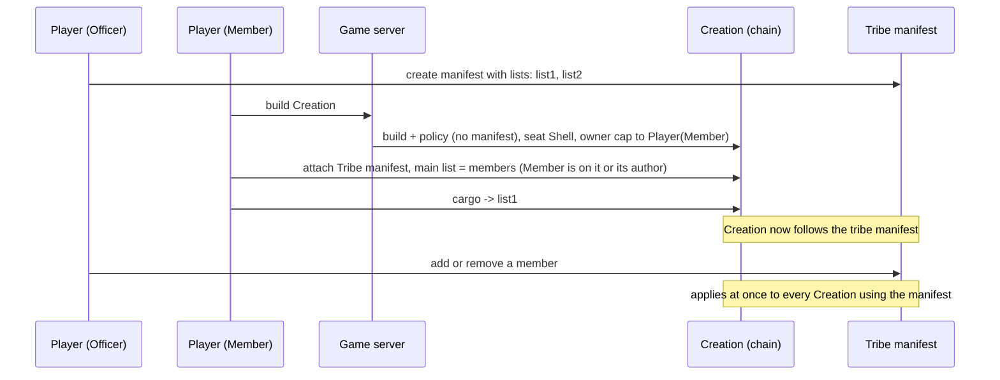
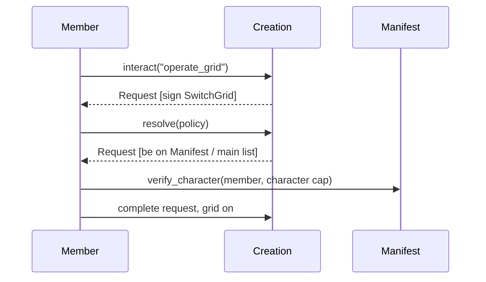
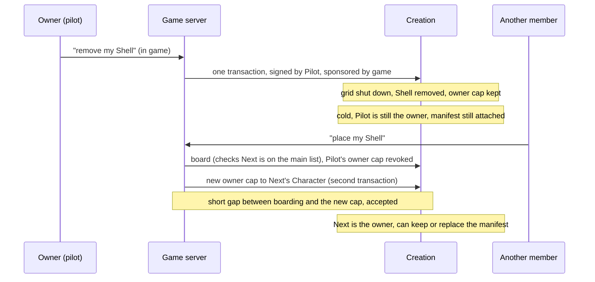
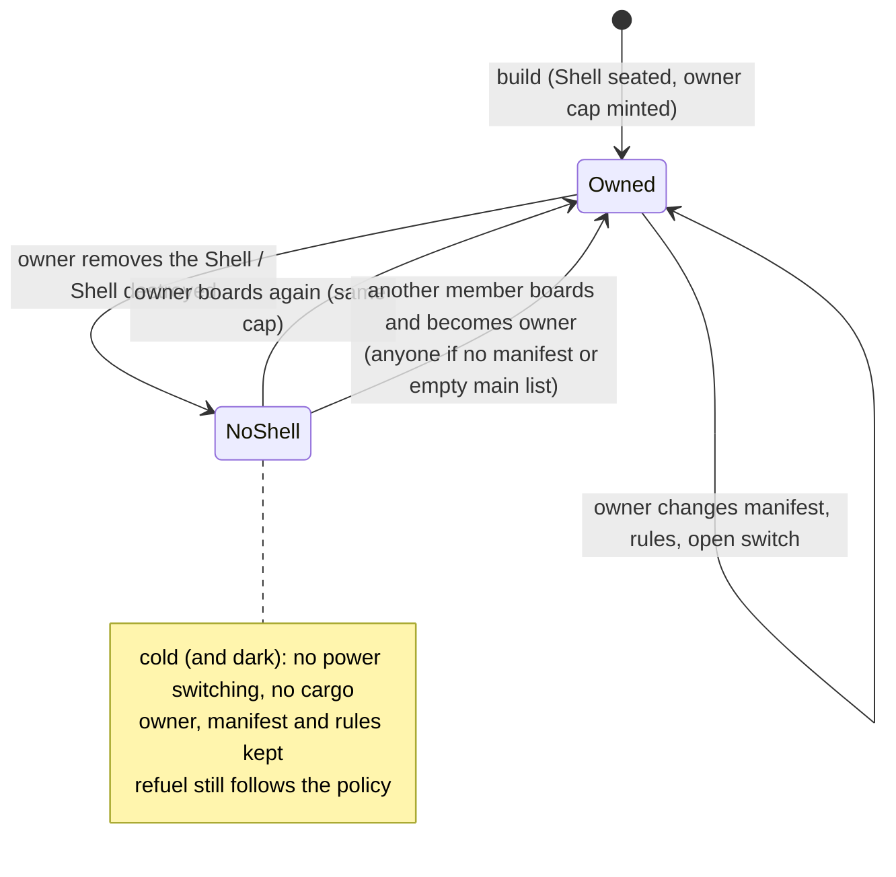
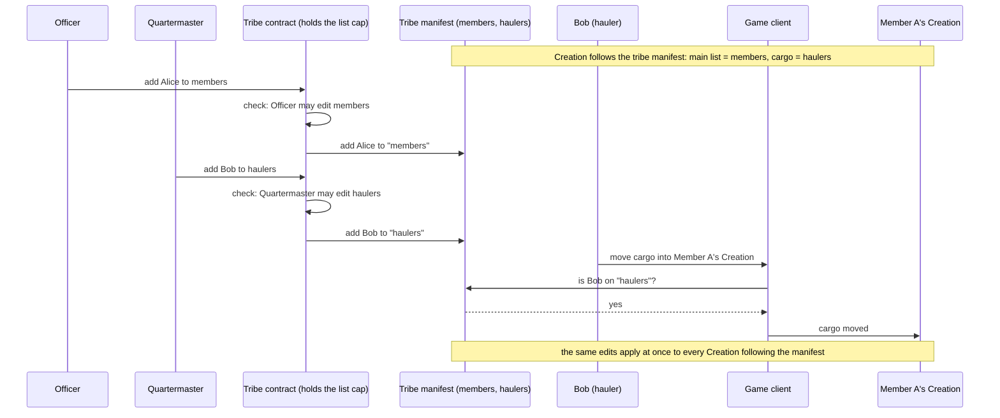
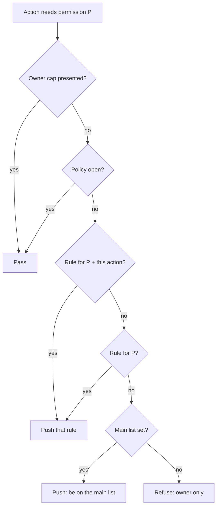

# 7. Access Control for Social Play

- **Status:** Proposed

## Motivation

Today a Creation (ship or structure) has one owner: the holder of its owner cap
(`AccessCap`). The cap sits on the owner's Character and is borrowed for every
owner action. That works for a single player, but sharing is hard:

- To let anyone else refuel, switch power or move cargo, the owner has to hand
the cap to a custom contract (a DAO or vault) that lends it out by its own
rules. Every group needs custom code.
- A cap sent to such a contract is stuck: only an Entity that has its own cap
can lend a parked cap today.
- Game actions check "is this the owner?" directly, so there is no way to say "these  
ten people may refuel, only I may change the rules".

This ADR adds **social play out of the box** (shared lists that a tribe/org can use  
on many Creations) while keeping the owner cap model, and lets builders extend  
the same rails with their own rules.

## Summary

Five ideas:

| Idea                              | In plain words                                                                                                                                                                              |
| --------------------------------- | ------------------------------------------------------------------------------------------------------------------------------------------------------------------------------------------- |
| **Owner**                         | The character who built the Creation or last placed their Shell in it. Removing the Shell doesn't change the owner. On chain: whoever holds the Creation's owner cap. The owner can always do everything. |
| **DataItems/Manifest/SharedList** | A shared object holding one or more named lists of characters (and bot or org wallets), e.g. a tribe's *members*, *haulers* and *controllers*. Someone creates it and keeps it up to date, e.g. a tribe officer. It is not part of a Creation: one manifest can be used by many Creations. |
| **Permission**                    | A name for a kind of action: switch the grid, run a module, refuel, move cargo, and so on. Actions ask for a permission instead of "the owner".                                             |
| **Policy**                        | Settings on each Creation: which manifest it follows and its main list, optional rules per permission, and an **open** switch that lets anyone do shared actions (boarding still follows the main list). |
| **Rule**                          | What someone other than the owner must meet for a permission: by default "be on the main list"; it can also be another list in the manifest, "anyone", or a builder's own check.        |

Who can do what by default:

| Action | Who |
|---|---|
| Refuel, switch power and modules, move cargo | The owner and everyone on the main list (or the list set for that action) |
| Edit a manifest and its lists | Whoever holds that manifest's list cap (its author) |
| Choose the Creation's manifest, set rules, set open | Owner only |
| Remove the Shell | Owner (pilot), from inside the game |
| Install, uninstall, destroy, merge, split, dock | The game server. It decides who may ask (e.g. merge only if you own both); the chain trusts it |
| Place a Shell in a Creation with no Shell | The owner; anyone on the main list; anyone at all if there is no manifest or the main list has no characters |

Key behaviours:

- **There is always an owner.** Removing or losing the Shell keeps the owner.
Ownership moves only when another character places their Shell.
- **The manifest stays.** Removing the Shell or changing owner keeps the
manifest and rules attached until the owner replaces them.
- **The owner always wins.** Removing the owner from the manifest doesn't take
their Creation away.
- **One pointer per Creation.** A Creation follows one manifest. A new owner
swaps all its lists at once by attaching a different manifest.
- **Cold and dark.** A Creation with no Shell is *cold*, which also makes it
*dark* (no power). Nobody can switch power or modules on a cold Creation, and
cargo can't move because the inventory is offline. Members can still refuel it.
- **Every Creation has a policy**

### End-to-end flows

**1. Build and share with a tribe**



**2. A member turns the grid on**



The owner skips the list: they borrow the owner cap from their Character and
present it instead (`verify_owner`).

**3. Remove the Shell and take over**



If Pilot places their own Shell again instead, nothing changes: they keep their
owner cap.

**4. Creation lifecycle**



**5. A tribe or DAO runs the manifest**



The tribe contract holds the manifest's list cap and decides who may edit which
list (here: officers edit *members*, the quartermaster edits *haulers*; it could
also be a vote). The game only checks the list. Each member chooses to follow
the tribe manifest on their own Creation, and can switch away. A group that
needs to control the Creation itself (so a member can't switch away) holds the
owner cap in its contract and lends it out by its own rules.

## Scope

**In scope:** owner cap kept as the ownership proof; shared manifests; named
permissions on power and inventory actions; per-Creation policy with rules and
the open switch; boarding and Shell removal with fixed rules; letting any object hold
and lend the owner cap; views and events.

**Out of scope (later):** builder rules on actions the game client builds
(refuel, game cargo); owner-only rules per action; a contract replacing the
owner cap entirely; private lists; time-limited and delegated access.

## On-chain design

All new code lives in `core`, which power, inventory and creation already
depend on.

### Data model

```move
// core::access_list — the manifest
public struct AccessList has store {
    name: String,                    // e.g. "members", "haulers"
    characters: Table<ID, bool>,     // character entity ids
    wallets: Table<address, ID>,     // bot / org key -> the character it acts for
}
public struct SharedAccessList has key {   // shared, usable by many Creations
    id: UID,
    version: u64,
    cap_id: ID,
    list: Table<ID, AccessList>,     // list id -> list; no duplicates
}
public struct ListCap has key, store { id: UID, manifest_id: ID }   // holder = author
public struct ListRef has copy, drop, store {   // one list inside a SharedAccessList
    manifest: ID,                    // the SharedAccessList's object id
    list: ID,                        // the list's key in its table
}

// core::access — a component on every Creation
public struct Policy has store {
    open: bool,                                      // anyone meets every permission
    main_list: Option<ListRef>,                      // the attached manifest and its main list; none = owner only
    rules: VecMap<RuleKey, vector<Requirement>>,
}
public struct RuleKey has copy, drop, store {
    permission: TypeName,                            // with_original_ids
    action: Option<String>,                          // none = every action
}
```

- **The list cap is the author's key** for the whole manifest. An officer keeps
it in their wallet; handing the manifest over is a transfer; a DAO stores it
inside its own object and can give each role its own edit rights.
- **Lists are never deleted**, only emptied, so no Creation can point at a
missing list. A builder retires a role by emptying it.
- **A list rule** is `[Member(ListRef)]`, for a list inside the attached
manifest. The attached manifest is `main_list.manifest`, so a main list can't
exist without a manifest.
- `Request` gains `action: Option<String>` (set by `entity::interact`) so a
rule can target one named action.

### Permissions

Each module defines its permission types; its handlers push the permission
instead of `owner_requirement()`.

| Permission | Guards | Built by |
|---|---|---|
| `SwitchGrid` | `set_power_grid` | any app |
| `OperateGenerator` | `set_generator`, `set_generator_fuel_type` | any app |
| `OperateFuelBay` | `set_fuel_bay` | any app |
| `OperateModule` | `set_desired_state`, `set_priority` | any app |
| `CargoIn` / `CargoOut` | `deposit*` / `withdraw*` between Creations | any app |
| `Refuel` | `deposit_fuel`, `deposit_fuel_item` | game client (sponsored) |
| `GameCargoIn` / `GameCargoOut` | moving items between the game and the Creation | game client (sponsored) |

### How a check resolves

A handler pushes `Access(P)` (or `ClientAccess(P)` for game-client actions).
Then either the owner presents the owner cap (`verify_owner`), or
`access::resolve` replaces it with the rule:



Game-client actions only honour a rule that is "anyone" (`[]`) or a single list
(`[Member(ListRef)]`); any other rule is skipped, because the game client can only
build list checks. That way a builder rule can never lock members out of
refuelling.

### Actions

| Who                               | Can                                                                                                                       |
| --------------------------------- | ------------------------------------------------------------------------------------------------------------------------- |
| Owner                             | Choose the manifest and its main list, point an action at another list, set other rules, open the Creation to everyone |
| Manifest author (list cap holder) | Create a manifest, add or rename lists, add or remove members                                                             |
| Member                            | Prove they are on a list                                                                                                  |
| Player + game server              | Board, remove the Shell                                                                                                   |
| Game server                       | Handle a destroyed Shell or a split section                                                                               |
| The contract itself               | Create the policy with every Creation; revoke the old owner when another character boards                                 |

Attaching needs the manifest's author (list cap holder) or a character on the
chosen main list. Replacing or
detaching the manifest removes every rule that points at a list of the old
manifest, permission-wide and per-action. Lists are never deleted, only
emptied. Anyone in a request satisfies a permission with `access::verify_owner`
(owner cap) or `access::resolve` (the rule).

Every handler ships a `*_template` for PTB discovery (see
[0002](0002-modular-architecture.md)).

### Rules

- **Owner always passes.** Ownership comes from the cap, not the list.
- **Attach by author or membership.** The owner can attach a manifest they
authored (they present its list cap) or one whose chosen main list has their
character on it. Per-action lists must come from the same
manifest.
- **Boarding** needs no Shell aboard. The owner boards with their owner cap and  
keeps it. Anyone else boards by the main list (anyone if there is no manifest  
or the main list has no characters); boarding revokes the old owner cap and  
the new owner gets a fresh one. The game server checks the Shell belongs to  
the boarding character before sponsoring.
- **Removing the Shell** is one transaction: owner cap, game-server sponsor,
grid shut down, Shell removed. The owner cap stays valid. The game server only
sponsors it for the pilot. If a contract holds the cap, it must hand it back to
the pilot's Character first. A destroyed Shell does the same through
`clear_shell`.
- **Cold: no switching.** Power handlers refuse while no Shell is aboard.
Cargo needs its inventory online, which also needs a Shell; refuel doesn't.
- **Split sections.** One game-server transaction: the section without the
Command Module is set open; the one with it keeps the policy and pilot.
- **List entries are plain ids**, added only by the manifest author. There is no
on-chain check that an entry is a character; the game server checks the
boarding character before paying.
- **Rules are all-of**; an empty rule means anyone. Rules survive a change of
owner, like the manifest.

### Builder extensions

| Builders can | How |
|---|---|
| Hold the owner cap in a vault, DAO or multisig | Send it to their object; lend it with `access_cap::receive` and a return-only receipt |
| Add their own checks (roles, votes, tokens, limits) | Owner sets them as a permission's rule, for every action or one named action |
| Add permissions for their own components | Push `access::requirement<MyPerm>()`; the same policy governs it |
| Run a manifest from a contract | Keep the list cap in their object; give roles their own edit rights over single lists; edit after a vote, role change or token check |
| Add owner-enabled actions | `entity::enable_action` with their own requirements |
| Follow Creations, not owners | Views and events for owner, manifest, rules and open switch |

## Alternatives considered

| Option | Verdict | Why |
|---|---|---|
| One cap per action | Rejected | Only one holder per action, so many members can't share a right |
| Tribe holds the owner cap, members borrow it by role | Left to builders | Every borrow writes one shared object, and the borrower gets every owner right |
| One list per shared object | Rejected | A new owner re-points every list, and the game reads many objects |
| A list stored on each Creation | Rejected | A tribe edits every Creation on each join or leave |
| A contract replaces the owner cap | Later | Needs a game decision; a Shell change still resets it |
| Separate settings for game-client actions | Later | One rules map gives the same protection with fewer functions |

## Future direction

This ADR keeps the first version small. Later steps build on the same model:

- **Authorship with proof:** hand a manifest to a specific character, or to a
contract that agrees, instead of transferring the list cap.
- **Pilot on chain:** record who is aboard so Shell removal is checked on chain, not
only by the game server.
- **Lists from several authors** on one Creation, e.g. a tribe's members plus an
ally's haulers.
- **Builder rules on game-client actions:** refuel and game cargo run builder
checks through PTB templates and a sponsor allowlist.
- **A contract as owner:** a contract replaces the owner cap entirely, once the  
game decides a contract may outrank the pilot.

## Open questions

1. Should `set_rule` and `enable_action` reject core markers (e.g. the revoke

   requirement) so a rule can never strip the owner?
2. Builder rules on refuel and game cargo: needs the game server to sponsor

   builder calls safely (templates plus an allowlist).
3. Owner-only rules per action.
4. Refuel with no Shell: allowed for the owner and members (it only adds fuel,

   and avoids a Creation that can never come back online). Needs game design  
   confirmation.
5. Which in-game actions are shared and which are owner-only is game design's
   call. The chain only enforces sharing for actions that are on chain.
6. Should open also let anyone board a cold Creation? Today boarding follows the
   main list.

## Consequences

**Easier:** players share Creations without code; one tribe manifest serves many
Creations and updates everywhere at once; builders reuse the same policy for
their own rules, permissions and lists; the owner cap can live in any contract.

**Harder:** every owner-gated handler moves to a named permission; one list cap
edits every list in a manifest unless a contract splits it; a manifest
author is trusted by everyone following their manifest (emptying the main list lets anyone take
over a Creation with no Shell); frequent removals need a transaction (a list is stale
until edited); the game server stays responsible for checking presence and
Shell ownership.
